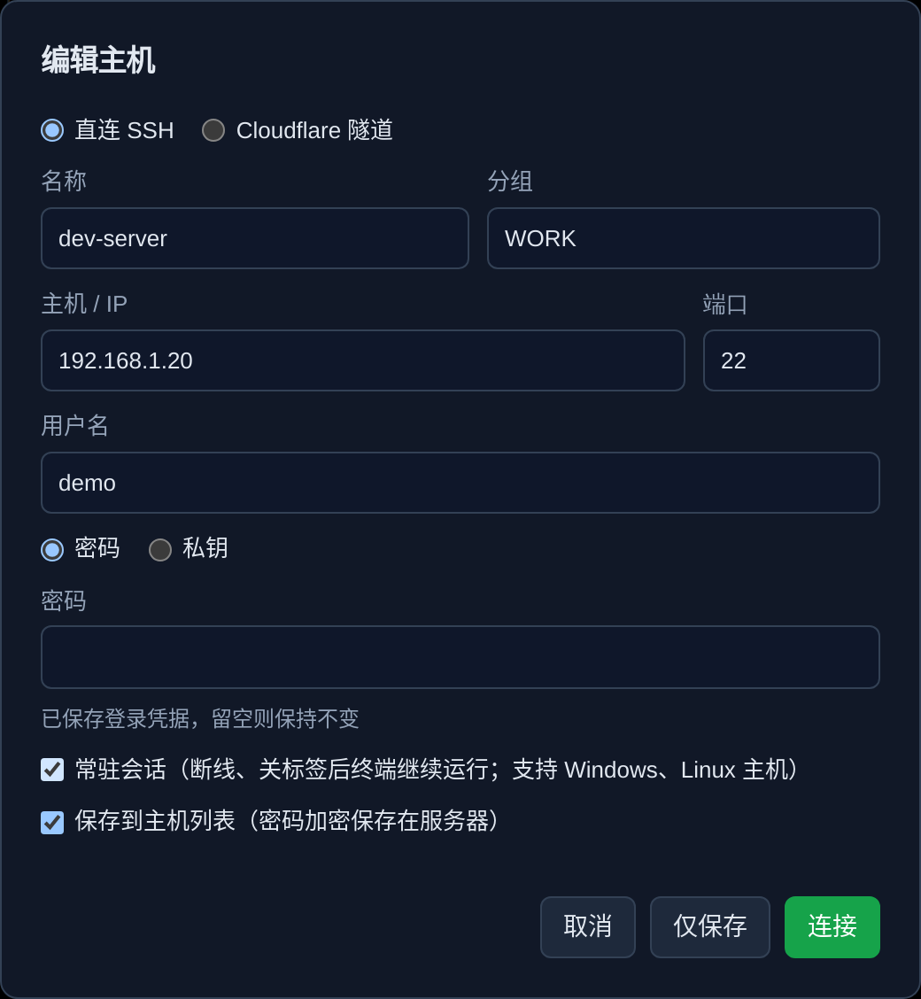
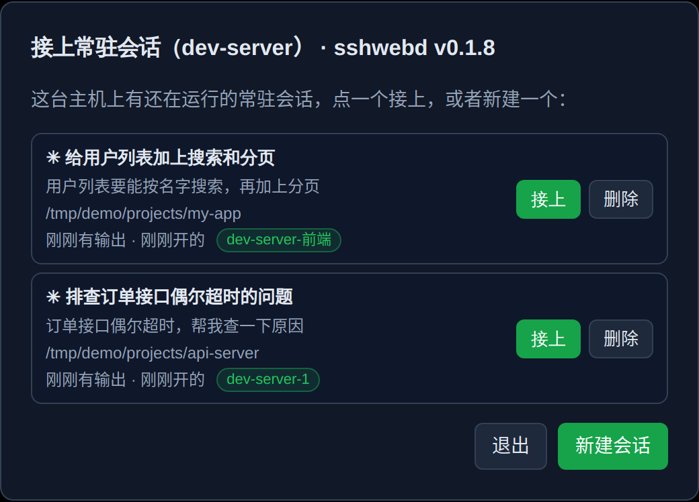

# SSH-WEB

[](https://github.com/yougelabview66/SSH-WEB-Public/actions/workflows/test.yml) [](LICENSE)

[English](README.md) | [简体中文](README.zh-CN.md)

A lightweight, self-hosted web SSH terminal built for running AI coding agents (Claude Code, Codex, Gemini …) on remote machines from any device. Runs in a single Docker container — ideal for a NAS. The interface is currently in Chinese.

<p align="center">
  
</p>
<p align="center">
  
</p>

```
Browser (xterm.js) ──WebSocket──> SSH-WEB (Node.js + ssh2) ──SSH──────────────> target host
                                                          └─WSS (Cloudflare)──> cloudflared ──> host:22
```

## Why SSH-WEB

Most web SSH clients are a terminal in a browser tab: close the tab and the session is gone, and on a phone they are barely usable. SSH-WEB is built around a different workflow — **an AI agent works on a remote machine for an hour while you check in from wherever you are.**

- **Nothing is lost when you leave.** The SSH connection is held by the server, not the browser. Close the laptop, switch networks, lock the phone — when you come back, the tab, the screen and the scrollback are exactly where you left them. No tmux required (it still works fine with tmux).
- **It knows what your agent is doing.** Each tab shows whether Claude Code is running, finished or waiting for you, with the task it is on. You get a push notification when it needs a decision, and on Android you can approve or deny a tool call straight from the notification.
- **Actually usable on a phone.** An input bar that plays well with Chinese/Japanese IMEs, Esc / Tab / Ctrl / arrow keys one tap away, local echo prediction on slow mobile links, and smooth scrolling through tmux history. Start a task on the desktop, continue on the phone — one device drives the layout at a time, so the screen never reflows back and forth.
- **Review the agent's work without leaving the terminal.** Browse the project, see what changed, leave comments on specific lines and send them back to the agent as one message.
- **Zero client install.** Only a browser is needed. Hosts behind NAT can be reached through a Cloudflare Tunnel without installing `cloudflared` on the device you are using.
- **Light enough for a NAS.** One Node.js container, no database (data is a few JSON files), all front-end assets bundled — it works on an offline LAN.
- **Safe defaults.** Without a password it only answers on localhost; saved credentials are encrypted; host keys are verified like OpenSSH; logins are rate limited.
- **Windows is a first-class target**, with cmd / PowerShell handling and optional persistent sessions through the bundled sshwebd daemon.
- **Well tested.** 60+ end-to-end tests drive a real browser against mock SSH servers.

## Use cases

- **Run Claude Code (or Codex, Gemini …) on a home server, NAS or cloud VM** and keep an eye on it from your phone — get notified when it finishes or needs approval, answer, and put the phone away.
- **One dashboard for all your machines.** NAS, VPS, GPU box and the Windows PC in one tab bar, with a status card showing which ones are busy, done or waiting.
- **Long-running jobs** such as model training, builds or backups: start them, close the browser, get a notification when they end.
- **Reach your homelab from anywhere**, including a borrowed or locked-down computer with no SSH client, through HTTPS or a Cloudflare Tunnel.
- **Quick code review of agent changes**: read the diff on the side bar, annotate lines, send the notes back to the agent.
- **Preview what the agent built**: open a dev server running on the remote host (e.g. `localhost:5173`) in your browser through the built-in port forwarder.

SSH-WEB is a single-user tool: one login protects everything. It is not meant for teams that need per-user accounts and permissions.

## Features

- **Persistent sessions** — SSH connections live on the server. Close the browser or lose the network, reopen, and every tab, screen and scrollback is restored. Open the same tab on phone and desktop at once.
- **Built for agents** — per-tab status (running / done / needs input), push notifications via Web Push or Claude Code hooks (with Allow / Deny buttons on Android), a floating status card, and a browser for past agent sessions.
- **Mobile-first input** — an input bar with special keys, IME-friendly editing, predictive local echo for slow links, fast local scrolling inside tmux.
- **Project side bar** — file tree with git status and file icons, fuzzy file search (Ctrl+Shift+P), diff view with line comments you can send to the agent.
- **Files & ports** — SFTP manager (drag-and-drop upload, preview), send images/files to the agent, preview dev servers through the built-in port forwarder.
- **Persistent sessions (recommended)** — terminals run inside a tiny daemon on the host ([sshwebd](sshwebd/README.md)), so they survive disconnects, closed tabs and SSH-WEB restarts. Windows and Linux.
- **Windows hosts** — cmd / PowerShell support, performance monitor and port list, persistent sessions on ConPTY.
- **Monitoring** — CPU, memory, network, disk and process charts per host; latency indicator.
- **Cloudflare Tunnel** — connect to hosts exposed through `cloudflared` (Service Token supported), no client needed.
- **Security** — login with rate limiting, TOTP prompts, host key verification (known_hosts style), credentials encrypted with AES-256-GCM, optional host allow-list.
- Light / dark themes, saved hosts with groups, command history and favorites, works offline on a LAN.

Detailed feature notes (Chinese): [docs/功能详细说明.md](docs/功能详细说明.md)

## Recommended: turn on persistent sessions

Tick **常驻会话 (persistent session)** in the host settings — it is on by default for new hosts. SSH-WEB uploads a small daemon (`sshwebd`, ~3 MB, a few MB of RAM) to the host and runs your terminal inside it:

- The terminal keeps running when the network drops, the browser tab is closed, or SSH-WEB itself restarts. Reconnecting resumes it and only replays what you missed.
- Open a new tab and pick any session that is still running — each shows its folder and what the agent is doing — or delete ones you no longer need.
- Works on **Windows** (replaces psmux) and **Linux** (amd64 / arm64 / armv7). You no longer need tmux to keep sessions alive; using tmux inside still works as before.
- Other hosts (e.g. macOS) simply open a normal terminal.

<p align="center">
  
  &nbsp;
  
</p>

## Quick start

```bash
git clone https://github.com/yougelabview66/SSH-WEB-Public.git
cd SSH-WEB-Public
# set AUTH_PASSWORD in docker-compose.yml first
docker compose up -d --build
```

Open `http://<server-ip>:8888`. All data lives in `./data` — back up that folder.

Or use the pre-built image (amd64 / arm64), no clone needed:

```bash
docker run -d --name ssh-web --restart unless-stopped \
  -p 8888:8888 -v $(pwd)/data:/data -e AUTH_PASSWORD=change-me \
  ghcr.io/yougelabview66/ssh-web:latest
```

## Configuration

| Variable | Default | Description |
|---|---|---|
| `AUTH_USER` / `AUTH_PASSWORD` | `admin` / empty | Web login. **Without a password only direct local access (127.0.0.1) is allowed** — set one to use it from other devices. |
| `PORT` / `HOST` | `8888` / `0.0.0.0` | Listen address. |
| `SECRET` | auto | Cookie signing and credential encryption key (stored in `data/.secret`). Losing it makes saved passwords unreadable. |
| `COOKIE_SECURE` | `false` | Set `true` when served over HTTPS. |
| `SESSION_HOURS` | `720` | Idle time before re-login is required. |
| `ALLOWED_HOSTS` | any | Comma-separated allow-list, e.g. `192.168.1.*,*.example.com`. |
| `HOSTKEY_POLICY` | `ask` | `ask`, `accept-new` or `off`. |
| `TRUST_PROXY` | private ranges | Which proxies may set `X-Forwarded-For`. |
| `BG_TIMEOUT_HOURS` | `168` | Disconnect background sessions nobody viewed for this long (`0` = never). |
| `MAX_SESSIONS` | `30` | Max background sessions. |
| `SCROLLBACK` | `5000` | Scrollback lines kept per session. |
| `PUID` / `PGID` | unset | Run as this user instead of root. |

## Security

SSH-WEB is a gateway to every server it can reach. When exposing it to the internet:

- set a strong `AUTH_PASSWORD` and `COOKIE_SECURE=true`;
- put it behind HTTPS, ideally with Cloudflare Access or another SSO in front;
- verify host fingerprints on first connect and keep host key checking on;
- restrict targets with `ALLOWED_HOSTS`.

Please report vulnerabilities privately — see [SECURITY.md](SECURITY.md).

## Development

```bash
npm install
AUTH_PASSWORD=test npm start

npx playwright-core install chromium   # first time only
npm test                          # or: npm test -- desk lat
```

Tests drive a real browser against mock SSH servers on 127.0.0.1; nothing touches real hosts. See [CONTRIBUTING.md](CONTRIBUTING.md). Server code is in `lib/`, front-end modules in `public/app/` (concatenated in numeric order), the terminal daemon in `sshwebd/` (Go, Windows ConPTY + Linux pty).

## Acknowledgements

Inspired by [webssh](https://github.com/huashengdun/webssh), [webssh2](https://github.com/billchurch/webssh2), [sshwifty](https://github.com/nirui/sshwifty) and [Orca](https://github.com/stablyai/orca). Built on [xterm.js](https://xtermjs.org/) and [ssh2](https://github.com/mscdex/ssh2).

## License

[MIT](LICENSE)
