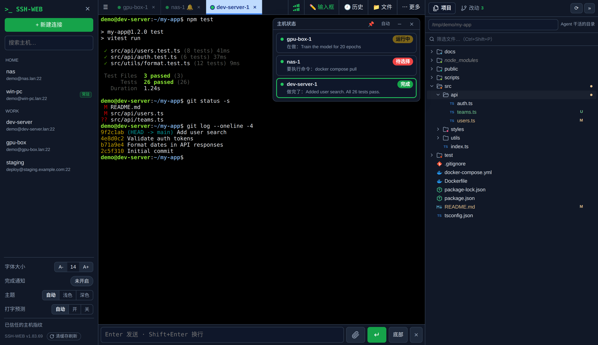
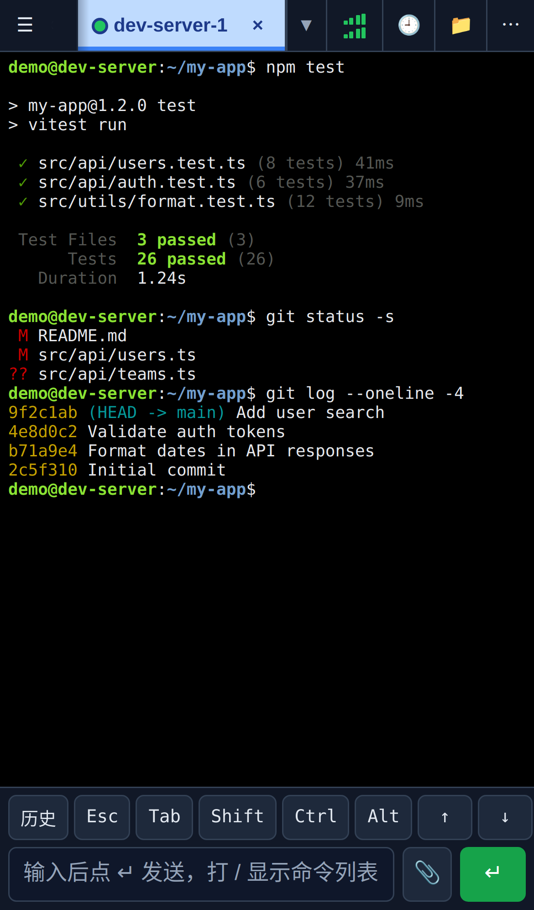

# SSH-WEB

[English](README.md) | [简体中文](README.zh-CN.md)

A lightweight, self-hosted web SSH terminal built for running AI coding agents (Claude Code, Codex, Gemini …) on remote machines from any device. Runs in a single Docker container — ideal for a NAS. The interface is currently in Chinese.

<p align="center">
  
</p>
<p align="center">
  
</p>

```
Browser (xterm.js) ──WebSocket──> SSH-WEB (Node.js + ssh2) ──SSH──────────────> target host
                                                          └─WSS (Cloudflare)──> cloudflared ──> host:22
```

## Features

- **Persistent sessions** — SSH connections live on the server. Close the browser or lose the network, reopen, and every tab, screen and scrollback is restored. Open the same tab on phone and desktop at once.
- **Built for agents** — per-tab status (running / done / needs input), push notifications via Web Push or Claude Code hooks (with Allow / Deny buttons on Android), a floating status card, and a browser for past agent sessions.
- **Mobile-first input** — an input bar with special keys, IME-friendly editing, predictive local echo for slow links, fast local scrolling inside tmux.
- **Project side bar** — file tree with git status and file icons, fuzzy file search (Ctrl+Shift+P), diff view with line comments you can send to the agent.
- **Files & ports** — SFTP manager (drag-and-drop upload, preview), send images/files to the agent, preview dev servers through the built-in port forwarder.
- **Windows hosts** — cmd / PowerShell support and optional persistent sessions via [sshwebd](sshwebd/README.md), a tiny ConPTY daemon that keeps terminals alive across disconnects.
- **Monitoring** — CPU, memory, network, disk and process charts per host; latency indicator.
- **Cloudflare Tunnel** — connect to hosts exposed through `cloudflared` (Service Token supported), no client needed.
- **Security** — login with rate limiting, TOTP prompts, host key verification (known_hosts style), credentials encrypted with AES-256-GCM, optional host allow-list.
- Light / dark themes, saved hosts with groups, command history and favorites, works offline on a LAN.

Detailed feature notes (Chinese): [docs/功能详细说明.md](docs/功能详细说明.md)

## Quick start

```bash
git clone https://github.com/yougelabview66/SSH-WEB-Public.git
cd SSH-WEB-Public
# set AUTH_PASSWORD in docker-compose.yml first
docker compose up -d --build
```

Open `http://<server-ip>:8888`. All data lives in `./data` — back up that folder.

Without compose:

```bash
docker build -t ssh-web .
docker run -d --name ssh-web --restart unless-stopped \
  -p 8888:8888 -v $(pwd)/data:/data -e AUTH_PASSWORD=change-me ssh-web
```

## Configuration

| Variable | Default | Description |
|---|---|---|
| `AUTH_USER` / `AUTH_PASSWORD` | `admin` / empty | Web login. **Without a password only direct local access (127.0.0.1) is allowed** — set one to use it from other devices. |
| `PORT` / `HOST` | `8888` / `0.0.0.0` | Listen address. |
| `SECRET` | auto | Cookie signing and credential encryption key (stored in `data/.secret`). Losing it makes saved passwords unreadable. |
| `COOKIE_SECURE` | `false` | Set `true` when served over HTTPS. |
| `SESSION_HOURS` | `720` | Idle time before re-login is required. |
| `ALLOWED_HOSTS` | any | Comma-separated allow-list, e.g. `192.168.1.*,*.example.com`. |
| `HOSTKEY_POLICY` | `ask` | `ask`, `accept-new` or `off`. |
| `TRUST_PROXY` | private ranges | Which proxies may set `X-Forwarded-For`. |
| `BG_TIMEOUT_HOURS` | `168` | Disconnect background sessions nobody viewed for this long (`0` = never). |
| `MAX_SESSIONS` | `30` | Max background sessions. |
| `SCROLLBACK` | `5000` | Scrollback lines kept per session. |
| `PUID` / `PGID` | unset | Run as this user instead of root. |

## Security

SSH-WEB is a gateway to every server it can reach. When exposing it to the internet:

- set a strong `AUTH_PASSWORD` and `COOKIE_SECURE=true`;
- put it behind HTTPS, ideally with Cloudflare Access or another SSO in front;
- verify host fingerprints on first connect and keep host key checking on;
- restrict targets with `ALLOWED_HOSTS`.

Please report vulnerabilities privately — see [SECURITY.md](SECURITY.md).

## Development

```bash
npm install
AUTH_PASSWORD=test npm start

npx playwright install chromium   # first time only
npm test                          # or: npm test -- desk lat
```

Tests drive a real browser against mock SSH servers on 127.0.0.1; nothing touches real hosts. Server code is in `lib/`, front-end modules in `public/app/` (concatenated in numeric order), the Windows daemon in `sshwebd/` (Go).

## Acknowledgements

Inspired by [webssh](https://github.com/huashengdun/webssh), [webssh2](https://github.com/billchurch/webssh2), [sshwifty](https://github.com/nirui/sshwifty) and [Orca](https://github.com/stablyai/orca). Built on [xterm.js](https://xtermjs.org/) and [ssh2](https://github.com/mscdex/ssh2).

## License

[MIT](LICENSE)
